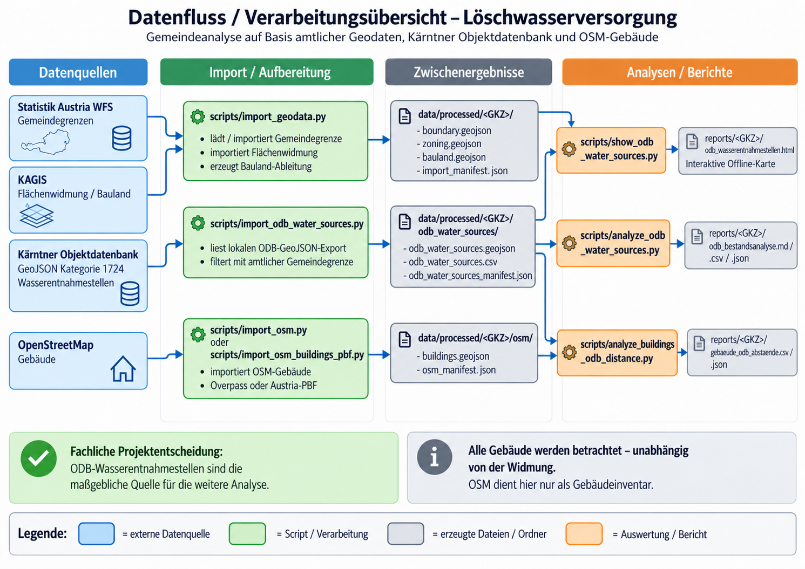

# Löschwasserversorgung – Analysewerkzeug (Referenzgemeinde Malta)

Analyseprojekt zur räumlichen Untersuchung der Siedlungsstruktur und zur **vorbereitenden** Bewertung der Löschwasserversorgung in Kärntner Gemeinden. Malta (20619) dient als bisherige Referenzgemeinde.

> **Status: Neuaufbau / fachliche Validierung ausständig.** Die vorhandenen Python-Prototypen und deren Grenzwerte sind noch nicht als gültige Löschwasserbedarfsberechnung freigegeben. Ergebnisse sind weder eine behördliche Feststellung noch ein Nachweis einer ausreichenden Löschwasserversorgung.

## Ziele

- Amtliche Gemeindegrenze, Flächenwidmung und rechtswirksame Bebauungspläne mit dokumentiertem Datenstand erfassen.
- OpenStreetMap-Gebäude nachvollziehbar klassifizieren und räumliche Siedlungsanalysen durchführen.
- Rechtliche Anforderungen, technische Richtwerte und algorithmische Heuristiken klar trennen.
- Erst nach fachlicher Validierung einen Löschwasserbedarf ableiten und später mit gesicherten Versorgungsdaten abgleichen.

## Bisheriger Prototyp (noch nicht veröffentlicht)

1. OSM-GeoJSON aus Overpass importieren und Wohngebäude-Kandidaten filtern.
2. Gebäudedichte in einem konfigurierbaren Radius ermitteln.
3. Gebäude mit DBSCAN clustern und Siedlungsflächen ableiten.

Die bisherige Kennzeichnung `800_lpm` basiert auf **nicht validierten Parametern** (Gebäudeanzahl/Dichte); sie darf nicht als normative Forderung interpretiert werden.

## Repository-Struktur

Die Übersicht folgt der tatsächlichen Ordnerstruktur des Repositories. Innerhalb jedes Verzeichnisses sind die Dateien alphabetisch aufgeführt. **Lokale Rohdaten und erzeugte Berichte werden nicht nach GitHub hochgeladen.**

### `config/` – Regeln und Konfiguration

- [`config/building_classification.json`](config/building_classification.json) – Konservative Klassifikation der OSM-Gebäudetags.
- [`config/firewater_rulebook.json`](config/firewater_rulebook.json) – Versionierter, noch fachlich zu validierender Entwurf der GK-/Löschwasser-Regelbasis; keine automatische Freigabe.
- [`config/reference_documents.json`](config/reference_documents.json) – Quellenkatalog mit Edition, Offline-Dateinamen und offiziellen Online-Links.

### `data/` – Datenquellen und lokale GIS-Daten

- [`data/sources.json`](data/sources.json) – Quellenregister der benötigten amtlichen und offenen Geodaten.
- `data/raw/` – Lokale Originaldateien, z. B. OSM-PBF, berechtigt exportierte ODB-Daten und BEV-ALS-Rasterausschnitte (**nicht eingecheckt**).
- `data/processed/` – Lokal erzeugte Gemeinde-, Gebäude-, Straßen-, Widmungs- und Wasserquellen-Geodaten (**nicht eingecheckt**).

### `docs/` – Projektdokumentation

- [`building-zoning-join.md`](docs/building-zoning-join.md) – Verknüpfung von Gebäuden mit Widmungsflächen.
- [`datenfluss-loeschwasserversorgung.svg`](docs/datenfluss-loeschwasserversorgung.svg) – Datenflussdiagramm als SVG.
- [`datenfluss_löschwasserversorgung_in_kärnten.png`](docs/datenfluss_l%C3%B6schwasserversorgung_in_k%C3%A4rnten.png) – Datenflussgrafik als PNG.
- [`datenqualitaet-methodik.md`](docs/datenqualitaet-methodik.md) – Datenqualität, Messunsicherheiten und Prüfansatz.
- [`einzelgebaeude-visualisierung.md`](docs/einzelgebaeude-visualisierung.md) – Offline-Ansicht einzelner Gebäude und Widmungsschnitte.
- [`gebaeudeklassen-und-loeschwasserbedarf.md`](docs/gebaeudeklassen-und-loeschwasserbedarf.md) – OIB-GK-Merkmale, TRVB-Regelentwurf und BEV-Höhenverfahren.
- [`gebaeudeklassifikation.md`](docs/gebaeudeklassifikation.md) – Grenzen der OSM-Gebäudeklassifikation.
- [`gemeinde-pipeline.md`](docs/gemeinde-pipeline.md) – Analyseablauf für Kärntner Gemeinden.
- [`gemeindebericht.md`](docs/gemeindebericht.md) – Aufbau und Erzeugung des Gemeindeberichts.
- [`geodaten.md`](docs/geodaten.md) – Geodaten und Herkunft.
- `docs/images/` – Abbildungen der Dokumentation.
- [`import.md`](docs/import.md) – Import und Vorbereitung der Daten.
- [`lizenzen-und-datenquellen.md`](docs/lizenzen-und-datenquellen.md) – Quellenangaben und Lizenzbedingungen.
- [`loeschwasserquellen-osm.md`](docs/loeschwasserquellen-osm.md) – Historische OSM-Wasserquellen-Bestandsaufnahme.
- [`odb-wasserentnahmestellen.md`](docs/odb-wasserentnahmestellen.md) – Aktuelle lokale ODB-Wasserquellen-Datenbasis.
- [`offene-datenbestaende-und-fragen.md`](docs/offene-datenbestaende-und-fragen.md) – Priorisierte Übersicht offener Datenbestände, Behördenfragen und nächster Arbeitsschritte (BEV-Adressen, Gebäudedaten, ODB, Regelwerke).
- [`osm-import.md`](docs/osm-import.md) – OSM-Import und Datenherkunft.
- [`projektcheck.md`](docs/projektcheck.md) – Prüfung von Umgebung und Datenbestand.
- [`rechtsgrundlagen.md`](docs/rechtsgrundlagen.md) – Rechtsgrundlagen und offene fachliche Fragen.
- [`skriptuebersicht.md`](docs/skriptuebersicht.md) – **Vollständiger Skriptkatalog:** Zweck, Eingaben, Ausgaben und Speicherorte.
- [`vergleich-wasserquellen.md`](docs/vergleich-wasserquellen.md) – Historische Vergleichsmethodik für Wasserquellendaten.

### `scripts/` – Datenimporte, Analysen und Offline-Berichte

Die Skripte sind hier alphabetisch aufgelistet. Eine ausführliche Erklärung **jedes Skripts** steht in der [Skriptübersicht](docs/skriptuebersicht.md).

- `analyze_buildings_als_height.py` – Gebäudehöhen aus passenden BEV-Rastern schätzen.
- `archive_reference_documents.py` – OIB-Referenz-PDFs offline archivieren, andere berechtigte PDFs importieren und Prüfsummen sichern.
- `analyze_buildings_odb_distance.py` – Luftlinienabstände der Gebäude zu ODB-Quellen.
- `analyze_odb_water_sources.py` – ODB-Bestandsstatistik.
- `building_context.py` – Hilfsmodul zur Gebäude-Lageansicht.
- `check_project.py` – Projekt- und Umgebungsprüfung.
- `classify_buildings.py` – Konservative OSM-Nutzungsindikatoren.
- `compare_osm.py` – Zwei OSM-Gebäudestände vergleichen.
- `compare_water_sources.py` – Historischer OSM-/ODB-Vergleich, **nicht aktive Wasserbasis**.
- `compare_zoning.py` – Zwei Widmungsstände vergleichen.
- `download_bev_als.py` – Ganze BEV-Rasterkacheln planen/herunterladen (sehr groß).
- `download_bev_als_subset.py` – Kleinen BEV-ALS-Testausschnitt abrufen.
- `generate_municipality_report.py` – Gemeindebericht erzeugen.
- `generate_report_index.py` – Lokale Startseiten `reports/index.html` und `reports/<GKZ>/index.html` erzeugen.
- `import_geodata.py` – Amtliche Gemeindegrenze und Widmung importieren.
- `inspect_bev_address_package.py` – Lokales BEV-Adresspaket (ZIP, GPKG, CSV) vor dem eigentlichen Import strukturell prüfen.
- `probe_bev_address_municipality.py` – Exakte Malta-Gemeindeschlüssel und Relationen zu BEV-Gebäudepunkten prüfen.
- `export_bev_municipality_addresses.py` – Amtliche BEV-Adress- und Gebäudereferenzpunkte für eine Gemeinde getrennt lokal exportieren.
- `join_bev_building_points_osm.py` – BEV-Gebäudereferenzpunkte konservativ mit OSM-Gebäudegrundrissen abgleichen; Rand- und Nahfälle getrennt prüfen.
- `show_bev_osm_review_map.py` – Offline-Prüfkarte für BEV/OSM-Nah-, Rand- und Nichttreffer mit Straßen, Gebäuden und Subcodes.
- `import_odb_water_sources.py` – Privaten ODB-Export lokal importieren.
- `import_osm.py` – Alternativer/älterer OSM-Gebäudeimport und Hilfsfunktionen.
- `import_osm_buildings_pbf.py` – OSM-Gebäude aus lokalem PBF importieren.
- `import_osm_roads_pbf.py` – OSM-Straßen/Wege aus lokalem PBF importieren.
- `import_water_sources.py` – Historischer OSM-Wasserquellenimport, **nicht aktiv**.
- `inventory_gk_building_attributes.py` – GK-relevante vorhandene/fehlende Gebäudemerkmale inventarisieren.
- `join_buildings_addresses.py` – Amtliche Adresspunkte geometrisch mit OSM-Gebäudegrundrissen verbinden und Prüffälle ausweisen.
- `join_buildings_zoning.py` – Gebäude und Widmung räumlich überlagern.
- `list_building_overlaps.py` – Mehrfachwidmungen als HTML/CSV prüfen.
- `municipality_text.py` – Hilfsmodul zur Korrektur von Textkodierung.
- `plot_osm_water_sources.py` – Historische OSM-Wasserquellenkarte, **nicht aktiv**.
- `process_bev_als_municipality.py` – Gemeindeweite, kachelweise BEV-Höhenauswertung.
- `report_v3.py` – Hilfsmodul für Gemeindebericht und Prüfausgaben.
- `review_building_als_heights.py` – Höhenqualität, gemeinsame Merkmaltabelle und Offline-Gebäudekarte.
- `run_municipality.py` – Frühere Gemeinde-Analysepipeline steuern.
- `show_building_zoning.py` – Einzelgebäude mit Widmungsschnitten anzeigen.
- `show_buildings_odb_distance.py` – Offline-Gebäude-/ODB-Abstandskarte.
- `show_odb_water_sources.py` – Offline-ODB-Wasserquellenkarte.
- `validate_firewater_rulebook.py` – GK-/Löschwasser-Regelwerksentwurf formal prüfen.

### Weitere Dateien und lokale Ergebnisse

- `.gitignore` – Schließt lokale virtuelle Umgebungen, Rohdaten und erzeugte Ergebnisse von Git aus.
- `LICENSE` – Repository-Lizenz.
- `README.md` – Projekteinstieg und Bedienung.
- `requirements.txt` – Python-Abhängigkeiten.
- `reports/` – Lokal erzeugte Karten, CSV-/JSON-Ergebnisse, Gemeindeberichte und das Referenzarchiv `reports/references/` (**nicht eingecheckt**). Einstieg über `reports/index.html`, erstellt mit `generate_report_index.py`.

Der Geodatenimport und die ältere Gemeinde-Pipeline wurden für Malta (20619) regressionsgeprüft und für Gmünd in Kärnten (20608) erfolgreich ausgeführt; siehe [Gemeinde-Pipeline](docs/gemeinde-pipeline.md). Eine fachlich validierte Löschwasserbedarfsberechnung und umfassende automatisierte Tests stehen noch aus.

## Git und lokale Entwicklungsumgebung (Windows)

Standardverzeichnis für lokale Projekte: `C:\pyprojects`. Die folgenden Befehle sind für **CMD (Eingabeaufforderung)** ausgelegt. In PowerShell funktioniert die Git-Bedienung gleich, aber die Aktivierung der virtuellen Python-Umgebung unterscheidet sich.

### Git auf einem neuen Rechner installieren (einmalig)

```powershell
winget install --id Git.Git -e --source winget
```

**Danach das Terminal schließen und neu öffnen**, damit `git` im PATH verfügbar ist.

```bat
git --version
```

### Repository zum ersten Mal klonen

Nur verwenden, wenn das Projektverzeichnis **noch nicht existiert**:

```bat
mkdir C:\pyprojects
cd /d C:\pyprojects
git clone https://github.com/lexxi/loeschwasserversorgung.git
cd loeschwasserversorgung
git status
```

Falls `C:\pyprojects` bereits existiert, ist `mkdir` nicht erforderlich. Ein vorhandenes lokales Projektverzeichnis nicht durch erneutes Klonen überschreiben.

### Lokalen Projektstand prüfen (besonders beim Rechnerwechsel)

```powershell
python scripts\check_project.py
```

Das Skript benötigt keine zusätzlichen Python-Pakete, führt keine Downloads oder Änderungen durch und zeigt die fehlenden Bestandteile sowie nächste Befehle an. Weitere Optionen: [Projektcheck](docs/projektcheck.md).

### Bestehendes Repository aktualisieren

```bat
cd /d C:\pyprojects\loeschwasserversorgung
git status
git pull --ff-only origin main
```

Bei lokalen Änderungen oder Konflikten nicht blind überschreiben: zuerst `git status` prüfen und Änderungen sichern.

### Änderungen prüfen und veröffentlichen

Nur beabsichtigte **Code- und Dokumentationsdateien** aufnehmen; keine ungeprüften GIS-Rohdaten, Ausgabedateien, Zugangsdaten oder die virtuelle Umgebung.

```bat
git status
git diff
git add README.md
git diff --cached
git commit -m "docs: update README"
git push origin main
```

`git add README.md` ist ein Beispiel. Für andere Änderungen gezielt die entsprechenden Dateipfade angeben. Nicht unkontrolliert `git add .` verwenden.

### Python-Umgebung (CMD)

```bat
cd /d C:\pyprojects\loeschwasserversorgung
py -m venv .venv
.\.venv\Scripts\activate.bat
python -m pip install --upgrade pip
python -m pip install -r requirements.txt
```

Unter **PowerShell** stattdessen die Umgebung mit `.\.venv\Scripts\Activate.ps1` aktivieren. Die Umgebung `.venv` bleibt lokal und gehört nicht ins Git-Repository.

## Schnellstart: Gemeindedaten auf einem neuen Rechner

Nach dem Klonen und `python -m pip install -r requirements.txt` werden die amtlichen Rohdaten und die OSM-Gebäude **lokal** importiert. Sie sind aus Lizenz- und Datenschutzgründen nicht im Git-Repository enthalten. Die Befehle im Projektverzeichnis ausführen:

```powershell
cd C:\pyprojects\loeschwasserversorgung
# Erster Lauf: amtliche ZIP-Dateien laden sowie OSM-Gebäude von Malta (20619)
python scripts\run_municipality.py --gemeinde 20619 --download-geodata --osm-download --repair-invalid
# Zweiter Lauf: dieselben amtlichen ZIP-Dateien wiederverwenden; OSM für Gmünd (20608)
python scripts\run_municipality.py --gemeinde 20608 --osm-download --repair-invalid
```

Ausgaben: `data/processed/20619/`, `data/processed/20608/` und `reports/<gemeinde>/gemeindebericht.md`. Die Datenverzeichnisse bleiben lokal und werden von Git ignoriert. Bei späteren Läufen auf demselben Rechner entfällt `--download-geodata`, sofern die ZIP-Dateien bereits unter `data/raw/` liegen. **Achtung:** Ein neuer Download kann einen anderen Datenstand liefern. `--repair-invalid` repariert ungültige Widmungspolygone ausdrücklich und dokumentiert die Anzahl; keine rechtliche Prüfung.

Gesamtliste der Überschneidungen für eine Gemeinde im Browser öffnen:

```powershell
python scripts\list_building_overlaps.py --gemeinde 20619 --open
python scripts\list_building_overlaps.py --gemeinde 20608 --open
```

Einzelne Gebäude und ihre Widmungs-Flächenschnitte lassen sich anschließend **ohne QGIS** als Offline-HTML zeigen:

```powershell
python scripts\show_building_zoning.py --gemeinde 20619 --open
python scripts\show_building_zoning.py --gemeinde 20608 --open
```

Dabei wählt man eine Nummer aus den angezeigten Grenzfällen oder gibt eine vollständige OSM-ID an. Anleitung: [Einzelgebäude-Visualisierung](docs/einzelgebaeude-visualisierung.md). Die vollständige Importdokumentation steht unter [Gemeinde-Pipeline](docs/gemeinde-pipeline.md).

### HTTPS-Zertifikatsfehler beim Geodaten-Download (Windows)

Wenn Python beim Download von Statistik Austria mit `CERTIFICATE_VERIFY_FAILED: self-signed certificate in certificate chain` abbricht, kann eine Firmenproxy-/TLS-Inspection-Zertifikatskette beteiligt sein. Der Importer verwendet deshalb `truststore` zur **weiterhin aktiven** Zertifikatsprüfung anhand des nativen Windows-Zertifikatsspeichers. Auf einem neuen Rechner einmal ausführen:

```powershell
git pull --ff-only origin main
python -m pip install -r requirements.txt
```

Danach den Gemeindeimport wiederholen. Voraussetzung: Die zuständige Stammzertifizierungsstelle ist korrekt im Windows-Zertifikatsspeicher installiert. Falls der Fehler bestehen bleibt, die Zertifikatskette durch die IT prüfen lassen; **nicht** die TLS-Prüfung abschalten (`verify=False`, unverified SSL-Kontext).

### Overpass überlastet (HTTP 502/503/504)

Ein öffentlicher Overpass-Server kann bei voller Warteschlange zeitweise mit `502 Bad Gateway` abbrechen. Das ist **kein** Fehler der lokalen Gebäude-/GIS-Verarbeitung. Nach einem erfolgreichen amtlichen Import lässt sich die Pipeline direkt beim OSM-Download fortsetzen:

```powershell
git pull --ff-only origin main
python scripts\run_municipality.py --gemeinde 20619 --skip-geodata --osm-download
```

Bei HTTP 429/502/503/504 folgen standardmäßig höchstens **zwei zusätzliche Versuche** mit Wartezeit (15 und 30 Sekunden). Alternativ kann ein anderer vertrauenswürdiger Overpass-HTTPS-Endpunkt mit `--overpass-url https://.../api` gewählt werden; öffentlichen Diensten keine schnellen unbegrenzten Wiederholungen zumuten. `--overpass-retries 0` schaltet die zusätzlichen Versuche ab. Ein dauerhaft ausgelasteter Endpunkt kann weiterhin fehlschlagen. Bereits vorhandene OSM-Daten lassen sich stattdessen über `--osm-input <datei.geojson>` verwenden.

## Löschwasserquellen: erste OSM-Bestandsaufnahme

Für Malta (20619) nach dem bestehenden Gemeindeimport:

```powershell
python scripts\\import_water_sources.py --gemeinde 20619 --download
```

Optional für Gmünd (20608):

```powershell
python scripts\\import_water_sources.py --gemeinde 20608 --download
```

Die Ergebnisdateien `water_sources.csv`, `water_sources.geojson` und `water_sources_manifest.json` liegen unter `data/processed/<GKZ>/water_sources/`. Die Erfassung nutzt explizite OSM-Feuerwehrwasser-Tags; sie prüft **weder Wasserverfügbarkeit noch Entnahmeleistung**. Weitere Angaben, Grenzen und Prüfschritte: [OSM-Löschwasserquellen](docs/loeschwasserquellen-osm.md).

### Objektdatenbank: lokale Fachdaten (getrennt von OSM)

Den über den berechtigten Objektdatenbank-Zugang gespeicherten GeoJSON-Export der Kategorie 1724 lokal nach `data/raw/odb_wasserentnahmestellen.geojson` legen. Danach:

```powershell
python scripts\import_odb_water_sources.py --gemeinde 20619 --input data\raw\odb_wasserentnahmestellen.geojson
```

Der Import filtert auf die amtliche Gemeindegrenze, übernimmt ID, Kategorie, Statusrohcode und Koordinaten und speichert lokale Ergebnisse unter `data/processed/20619/odb_water_sources/`. Keine Anmeldung oder API-Key-Verwendung durch dieses Skript. Details: [ODB-Wasserentnahmestellen](docs/odb-wasserentnahmestellen.md).

## Daten und Veröffentlichung

Die Nutzungsbedingungen sind für die einzelnen Quellen verschieden: **Statistik Austria (Gemeindegrenzen 2026): CC BY 4.0; Land Kärnten/KAGIS (Flächenwidmung): CC BY 4.0; OpenStreetMap (Gebäude): ODbL 1.0.** Für die **Kärntner Objektdatenbank** ist keine öffentliche Weitergabelizenz nachgewiesen: Die Exportdaten und standortbezogenen Ergebnisse bleiben lokal, solange keine geeignete Freigabe vorliegt.

Alle Quellenangaben, Metadaten-Nachweise und Hinweise zur Veröffentlichung: **[Lizenzen und Datenquellen](docs/lizenzen-und-datenquellen.md)**. Eine Datenlizenz ist nicht gleichbedeutend mit der Lizenz unseres Quellcodes.

## Rechtliche Hinweise

Siehe [Rechtsgrundlagen](docs/rechtsgrundlagen.md). Maßgeblich sind die jeweils geltenden Vorschriften und die fachliche Beurteilung durch die zuständigen Stellen.

## Lizenz

Der eigene Quellcode und die selbst erstellte Projektdokumentation stehen unter der **[MIT License](LICENSE)** (Copyright © 2026 lexxi). Sie erlaubt Nutzung, Änderung und Weitergabe unter Beibehaltung des Lizenzhinweises. **Externe Geodaten und fremde Inhalte sind davon nicht umfasst**: Für Statistik Austria, KAGIS, OSM und die Kärntner Objektdatenbank gelten weiterhin die jeweiligen eigenen Nutzungsbedingungen. Siehe [Lizenz- und Quellenübersicht](docs/lizenzen-und-datenquellen.md).

## Datenfluss



Die [illustrierte PNG-Übersicht](docs/datenfluss_löschwasserversorgung_in_kärnten.png) ist wegen ihrer anschaulichen Gestaltung wieder die Hauptgrafik. **Inhaltlicher Hinweis:** Sie zeigt den älteren Projektstand ohne die vollständige neue BEV-Adresszuordnung, ALS-Auswertung und Gemeinde-Rückfrageliste. Die [ergänzte technische SVG-Übersicht](docs/datenfluss-loeschwasserversorgung.svg) enthält diese neueren Verarbeitungsschritte. Beide Abbildungen sind deshalb derzeit nicht vollständig deckungsgleich.

## Gebäudeklassen und Löschwasseranforderungen

Die weitere Fachentwicklung ist in **zwei getrennte Arbeitspakete** gegliedert: **(1) Gebäudeklassen GK1–GK5 und Löschwasseranforderungen quellenbasiert definieren; (2) alle erfassten Gebäude anhand nachprüfbarer Daten zuordnen – mit ausdrücklicher Kennzeichnung unbekannter GK**. Tatsächliche Gebäude-GK und höchste planungsrechtlich zulässige GK werden für Objekt- bzw. Grundschutz separat behandelt. Die derzeitige OSM-Nutzungsklassifikation ist **keine** rechtlich gesicherte Gebäudeklasse. Details, technische Richtwerte, Rechtsgrundlagen und Links zu den Originaldokumenten: [Gebäudeklassen und Löschwasserbedarf](docs/gebaeudeklassen-und-loeschwasserbedarf.md).

**Technischer Stand AP 1 (v0.2.0):** [Versioniertes Regelwerk `config/firewater_rulebook.json`](config/firewater_rulebook.json) und [formaler Validator](scripts/validate_firewater_rulebook.py) sind vorhanden (`python scripts\validate_firewater_rulebook.py`). **Entwurf mit acht OIB-Varianten und sechs TRVB-Distanzstaffeln; keine automatische Gebäudeklassen- oder Bedarfszuordnung.**

## Skriptkatalog und Speicherorte

Für alle Python-Skripte sind **Zweck, benötigte Eingaben, erzeugte Dateien, Ablageorte und aktueller/historischer Status** in der [Skriptübersicht](docs/skriptuebersicht.md) dokumentiert. Für den BEV-ALS-Test bevorzugt [`download_bev_als_subset.py`](scripts/download_bev_als_subset.py) statt des vollständigen Kacheldownloads; die Originalkachel überschreitet das 8-GiB-Limit.

Für eine **gemeindeweite** BEV-ALS-Höheninventur ohne Vollkachel-Download: [`scripts/process_bev_als_municipality.py`](scripts/process_bev_als_municipality.py) (zuerst nur planen, danach `--download --max-tiles 3`, anschließend gesamte Auswahl und `--analyze`). Bedienung und Speicherorte: [Skriptübersicht](docs/skriptuebersicht.md).

**Höhenwerte prüfen und auf Offline-Karte ansehen:** Nach der gemeindeweiten ALS-Auswertung `python scripts/review_building_als_heights.py --gemeinde 20619 --open` ausführen. Erstellt die gemeinsame Gebäudemerkmals-CSV, einen Qualitätsbericht und eine klickbare Gebäudehöhenkarte unter `reports/20619/gk_inventory/`. Näheres in der [Skriptübersicht](docs/skriptuebersicht.md).

**Lokale Startseite für Karten und Berichte:** `python scripts/generate_report_index.py --gemeinde 20619 --open` erstellt `reports/index.html` und `reports/20619/index.html` mit Links auf alle bereits vorhandenen Unterseiten. Der Index bleibt lokal; ODB-Berichte nicht öffentlich veröffentlichen. [Details](docs/skriptuebersicht.md).

## Offline-Fachquellen

Die Referenzen zu GK und Löschwasser (OIB 2023, TRVB 137 F/21, ÖBFV VB-01/23 und Kärntner RIS-Recht) sind in [`config/reference_documents.json`](config/reference_documents.json) versioniert. Zum lokalen Bezug der drei öffentlich direkt abrufbaren OIB-PDFs und zur Aktualisierung der Offline-/Online-Links:

```powershell
python scripts\archive_reference_documents.py --download
python scripts\generate_report_index.py --gemeinde 20619 --open
```

Die Originale liegen **ausschließlich lokal** unter `reports/references/`, mit SHA-256-Manifest. Die technischen Richtlinien und RIS-Fassungen können bei entsprechender Berechtigung/Prüfung mittels `--import-file` aufgenommen werden. Nicht vorhandene Originale haben in der Indexseite nur einen Online-Link. [Bedienung und Rechtehinweise](docs/skriptuebersicht.md#offline-quellenarchiv-oib-trvb-öbfv-und-ris).

## AP3 – Amtliche Hausnummern

Für die Verknüpfung von **amtlichen Adresspunkten** mit OSM-Gebäuden wurde `scripts/join_buildings_addresses.py` ergänzt. Die tatsächlich vorhandene amtliche Datenquelle und deren Feldnamen müssen zuerst geprüft werden:

```powershell
python scripts\join_buildings_addresses.py --gemeinde 20619 --addresses "C:\Pfad\amtliche_adressen.geojson" --inspect
```

Erst anschließend ohne `--inspect` verknüpfen und die offline Gebäudehöhenkarte mit `python scripts\review_building_als_heights.py --gemeinde 20619 --open` neu erstellen. Nur geometrisch eindeutige Innen-Treffer werden verknüpft; nahe Adressen und Mehrfachtreffer bleiben Prüffälle. Sämtliche Adress-Rohdaten und Ergebnisse werden lokal gehalten. [Methodik und Beispiele](docs/skriptuebersicht.md#ap3--amtliche-hausnummern-mit-osm-gebäuden-verknüpfen).

### Gemeinde-Rückfragen und Glossar

Offene BEV/OSM-Fälle werden nicht durch Schätzung entschieden: `python scripts\export_bev_osm_municipality_questions.py --gemeinde 20619` erzeugt die lokale CSV zur fachlichen Rückfrage (standardmäßig 13 Nah- und 12 Nichttreffer). Die 2-m-Toleranzfälle lassen sich optional ergänzen, bleiben aber als vorläufig gekennzeichnet. Es erfolgt kein automatischer Versand.

`python scripts\generate_report_index.py --gemeinde 20619 --open` erzeugt außerdem `reports/glossar.html` und verlinkt das Offline-Glossar auf der zentralen und der kommunalen Startseite (BEV, OSM, ODB, ALS, OIB, GK, Qualitäts- und Prüfstatus).
