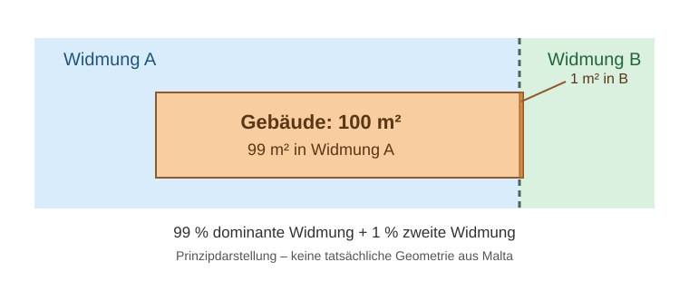

# Datenqualität und methodische Grenzen

**Stand:** 19.10.2026 · **Status:** Arbeitshypothesen und Prüfplan, **keine** abgeschlossene Fehlerursachenanalyse.

Diese Dokumentation hält fest, welche GIS-Ergebnisse gemessen wurden, was daraus tatsächlich folgt und welche Ursachen noch nicht belegt sind. Insbesondere dürfen Grenzüberdeckungen **nicht vorschnell** als Fehler der Kärntner KAGIS-Daten oder als geometrische Ungenauigkeit von OpenStreetMap bewertet werden.

## 1. Datengrundlage

- Gemeinde Malta, GKZ **20619**.
- Amtliche Gemeindegrenze: Gebietsstand 01.01.2026.
- Flächenwidmung Kärnten: aus dem landesweiten KAGIS-GeoPackage, für Malta extrahiert und nach EPSG:31287 transformiert.
- Gebäude: aktueller OSM/Overpass-Download, 1.686 Polygonobjekte.
- Räumliche Zuordnung: `representative_point()` und `within` als primärer Punkt-in-Polygon-Test; zusätzliche positive Flächenüberschneidungen der vollständigen Gebäudegrundrisse.
- Quellstände, SHA-256 und Ausgabedateien stehen in den lokalen Import-Manifesten. Die Rechtswirksamkeit aller einzelnen Widmungen ist nicht automatisch validiert.

## 2. Gemessene Ergebnisse

Die aktuelle Zuordnung von **1.686 Gebäuden** zu **540 Widmungsflächen** ergab:

| Messwert | Ergebnis |
| --- | ---: |
| Eindeutiger Punkt-in-Polygon-Treffer | 1.685 |
| Kein Punkt-Treffer, aber Gebäudeflächenüberdeckung | 1 |
| Ohne jede positive Flächenüberdeckung | 0 |
| Mehrfache Punkt-Treffer | 0 |
| Gebäude mit mindestens zwei Flächenschnitten | 432 |
| Gebäude mit genau einem Flächenschnitt | 1.254 |
| Gebäude mit zwei Flächenschnitten | 402 |
| Gebäude mit drei Flächenschnitten | 28 |
| Gebäude mit vier Flächenschnitten | 2 |
| Summe positiver Gebäude-Widmungs-Schnittpaare | 2.150 |

Für die **432 Gebäude mit mehreren Flächenschnitten**:

- Größte Überdeckung bei 95 Gebäuden: 99–100 % einer Gebäudegrundfläche.
- Größte Überdeckung bei 168 Gebäuden: 90–99 %.
- Größte Überdeckung bei 169 Gebäuden: 50–90 %.
- Zweitgrößte Überdeckung >=10 %: 167 Gebäude.
- Zweitgrößte Überdeckung <10 %: 265 Gebäude.
- Zweitgrößte Überdeckung >=50 %: **0 Gebäude**.
- Summierte Überdeckung aller Widmungen über 101 %: **0 Gebäude**.
- Maximale summierte Überdeckung: **100,0001 %** (wahrscheinlicher Rundungseffekt).

Die 432 Flächen-Mehrfachtreffer sind **nicht** 432 doppelte Gebäude: Der Ergebnisdatensatz bleibt bei 1.686 Gebäudeobjekten.

### Erläuterung: „Größte Überdeckung bei 95 Gebäuden: 99–100 %“

**Ja: Alle diese 95 Gebäude schneiden mindestens zwei Widmungspolygone.** Bei jedem dieser Gebäude deckt **eine einzelne, dominante Widmungsfläche 99–100 % der gesamten Gebäudegrundfläche** ab. Zusätzlich gibt es jeweils eine positive, meist sehr kleine Schnittfläche mit mindestens einem weiteren Widmungspolygon.

Das heißt **nicht**, dass 99–100 % aller 95 Gebäude Bauland sind. Die dominierende Widmung kann auch Grünland oder eine andere Kategorie sein. Ebenso ist nicht gesagt, dass jedes der 95 Gebäude exakt zwei Widmungsflächen schneidet – möglich sind zwei, drei oder vier. Die Verteilung *innerhalb dieser 95 Gebäude* wurde noch nicht separat ermittelt.

**Rechenbeispiel:** Ein Gebäude hat eine Grundfläche von 100 m². Davon liegen 99 m² in Widmung A und 1 m² in Widmung B. Es wird bei der Auswertung als **ein Gebäude mit zwei positiven Flächenschnitten** gezählt; seine **größte Überdeckung beträgt 99 %**. „99 %“ meint also den **Flächenanteil des einzelnen Gebäudes**, nicht den Anteil der Gebäude im gesamten Datensatz.

*Prinzipdarstellung, nicht maßstabsgetreu und keine gemessene Geometrie aus Malta. Die Bezeichnungen A und B sind Platzhalter und keine Aussage über Bauland/Grünland.*

**Methodische Einordnung:** Bereits ein schmaler Flächenstreifen mit positiver Schnittfläche erzeugt einen weiteren Treffer. Daraus folgt allein noch kein Datenfehler, und es lässt sich ohne Referenzprüfung nicht entscheiden, ob die Abweichung von tatsächlichen Grenzlagen, unterschiedlichen Datengrundlagen oder geometrischen Ungenauigkeiten stammt. Eine automatische Widmungszuordnung nach 99 % wird nicht vorgenommen.

### Bekannter Einzelfall

OSM `way/405910040`, `building=residential`:
- Grundfläche laut OSM: ca. 102,61 m².
- Kein Punkt-in-Polygon-Treffer.
- Positiver Schnitt mit KAGIS-`OBJECTID 5227706`, `Bauland – Dorfgebiet`: **3,8978 m² = 3,7986 %** der Gebäudegrundfläche.
- Abstand des Repräsentativpunkts zur nächsten Widmungsfläche: rund **4,14 m**.

**Konsequenz:** Kein automatisches Umschreiben auf „Bauland“ aufgrund einer geringfügigen Überschneidung; Status `overlap_review` bleibt nachvollziehbar.

## 3. Was die Befunde belegen – und was nicht

**Belegt:** Unser Verfahren zählt bereits kleinste **positive** Geometrieschnittflächen als zusätzliche Treffer. Gebäudegrundrisse können mehrere Widmungspolygone schneiden. Die Summen deuten bei den untersuchten Gebäuden nicht auf großflächige doppelte Überdeckung der KAGIS-Polygone hin.

**Nicht belegt:** Dass 432 Widmungsfehler vorliegen; dass KAGIS „schlechte Daten“ hat; dass OSM-Gebäude falsch digitalisiert wurden; dass es ausschließlich Rundungsfehler sind; dass eine bestimmte Widmung automatisch rechtswirksam oder einem vollständigen Gebäude zuzuschreiben ist.

**Plausible, noch ungeprüfte Erklärungen:**
1. **Auswertemethode:** Jede Flächenüberschneidung >0 wird registriert, selbst geringfügige Randkontakte mit positiver Fläche.
2. **Unterschiedliche Erfassung:** OSM-Gebäude und amtliche Widmungsflächen stammen aus verschiedenen Datenbeständen und möglicherweise unterschiedlichen Erfassungsgrundlagen.
3. **Tatsächliche Grenzlagen:** Ein Gebäude kann real über Widmungsgrenzen reichen.
4. **Geometrische Ungenauigkeiten/Transformation:** Möglich, aber ohne Vergleich zu Referenzdaten nicht nachgewiesen. Beide Datensätze werden in EPSG:31287 verglichen.
5. **Fehler in Quelldaten:** Möglich, jedoch auf Basis der vorliegenden statistischen Auswertung **nicht nachweisbar**.

## 4. Methodische Entscheidungen

- **Keine automatische 10-%-Regel.** 10 % kann als technischer *Prüfwert* zur Priorisierung dienen, ist aber **keine Rechtsnorm** und keine Regel zum Vergeben von Widmungsattributen.
- **Keine automatische Dominanz-Zuordnung** nach größtem Flächenanteil ohne dokumentierte und geprüfte Fachregel.
- Die Zuordnung über `representative_point()` ist rechnerisch gültig, bedeutet aber **nicht**, dass die gesamte Gebäudegrundfläche in derselben Widmung liegt.
- Die Flächenanteile der Widmungen dürfen nicht blind aufsummiert werden, wenn überlappende Polygonflächen existieren.
- Technische GIS-Qualitätskriterien und die spätere **Löschwasserbedarfsermittlung** bleiben getrennt.
- Mehrfachfälle und Grenzfälle werden explizit markiert, nicht entfernt oder stillschweigend bereinigt.

## 5. Prüfplan für die Ursachenanalyse

1. **Reproduzierbare Stichprobe** aus den Grenzfällen ziehen, etwa je 10 Objekte mit zweitgrößter Überdeckung <5 %, 10–30 % und >30 %, soweit genügend Fälle vorhanden sind. Auswahlliste und Parameter versionieren.
2. In **QGIS** gemeinsam anzeigen: OSM-Gebäude, KAGIS-Widmung, amtliche Digitale Katastralmappe (DKM) und möglichst aktuelles Orthofoto. Für alle Referenzquellen Datenstand und Nutzungslizenz dokumentieren.
3. Je Fall beurteilen, ob die Differenz plausibel durch tatsächliche Widmungsgrenze, Gebäudeerfassung, Datenstand, Transformation oder Geometrieartefakte entsteht. Bei unklaren Fällen „Ursache ungeklärt“ dokumentieren.
4. Vollständige Gebäudeüberdeckung, zweitgrößten Anteil, Anzahl überlagerter Widmungen und Abstände statistisch auswerten. Ggf. Topologie der *Widmungspolygone selbst* unabhängig von den Gebäuden prüfen.
5. Erst danach eine nachvollziehbare technische Toleranz oder Prüfkategorisierung definieren, testen und dokumentieren. Eine automatische fachliche Widmungszuordnung erfordert zusätzliche Regeln und gegebenenfalls amtliche Klärung.

## 6. Offene Aufgaben

- Auswerteskript zur reproduzierbaren Grenzfall-Stichprobe und QGIS-Layerdarstellung.
- Abgleich mit DKM und Orthofoto.
- Nachweis, ob Unterschiede aus OSM, KAGIS oder Methode entstehen.
- Fachliche Prüfung der Bedeutung von Grenzüberdeckungen für eine spätere Löschwasseranalyse.
- Keine Veröffentlichung von nicht freigegebenen Infrastruktur- oder Versorgungsdaten.

**Merksatz:** Eine geometrische Überschneidung ist zunächst ein *räumlicher Befund*, kein Beleg für einen Datenfehler und keine behördlich geprüfte Widmungs- oder Löschwasserfeststellung.
