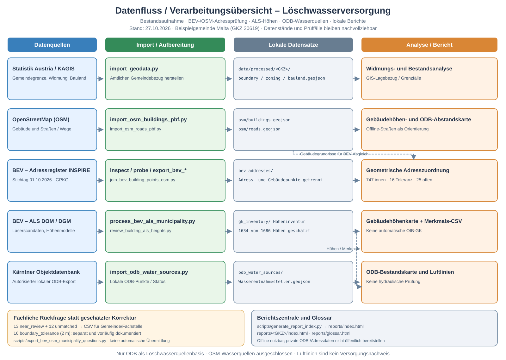

# Kärntner Objektdatenbank: Wasserentnahmestellen (lokaler GeoJSON-Import)

Die Objektdatenbank `kaernten.objektdatenbank.at` verwaltet Objekte, die anschließend in der Feuerwehr-Einsatzanwendung angezeigt werden können. Die beiden Anwendungen haben unterschiedliche Schnittstellen. Für unseren Import verwenden wir zunächst **nur einen lokal und berechtigt gespeicherten GeoJSON-Export** aus der Objektdatenbank; es wird kein API-Key benötigt oder übertragen.

## Herkunft und Kategorien

Die in der Anwendung sichtbare Hauptkategorie **1724 – Wasserentnahmestellen** hat folgende Unterkategorien:

| Kategorie | ODB-Kategorie-ID |
| --- | ---: |
| Bach mit Stau | 1729 |
| Löschwasserteich | 1730 |
| Saugstelle | 3953 |
| Überflurhydrant | 1728 |
| Unterflurhydrant | 1727 |

Der erste manuell geprüfte Export enthielt **41 Objekte**, davon 32 Überflurhydranten, 3 Unterflurhydranten, 3 Bach mit Stau, 2 Saugstellen und 1 Löschwasserteich. `sliceddata=0`. Statuscodes: 40 × `1`, 1 × `2`. **Status 1 bedeutet „verwendbar“, Status 2 „eingeschränkt verwendbar“, Status 3 „nicht verwendbar“** (laut Rückmeldung aus der Objektdatenbank). 41 ist die Anzahl der exportierten Features, nicht bereits die GIS-geprüfte Anzahl innerhalb der amtlichen Gemeindegrenze.

## Export und Import

Im **angemeldeten Browser**, soweit der Benutzer dazu berechtigt ist, kann die Kategorieansicht GeoJSON über `/backend/export/geojson/kategorie/1724` laden. Ob dieser Webendpunkt für direkte API-Key-Authentifizierung vorgesehen ist, ist noch **nicht** geklärt. Keine Session-Cookies oder API-Schlüssel in Projektcode, Chats oder Git speichern.

Den GeoJSON-Export lokal z. B. unter `data/raw/odb_wasserentnahmestellen.geojson` ablegen. Danach:

```powershell
git pull --ff-only origin main
python scripts\import_odb_water_sources.py --gemeinde 20619 --input data\raw\odb_wasserentnahmestellen.geojson
python scripts\check_project.py --gemeinde 20619
```

Das Skript erwartet vorhandene amtliche `data/processed/20619/boundary.geojson` und `import_manifest.json`, nutzt die Gemeindegrenze als räumlichen Filter und schreibt unter `data/processed/20619/odb_water_sources/`:

- `odb_water_sources.csv` (Semikolon, UTF-8 mit BOM),
- `odb_water_sources.geojson` (nur Objekt-ID, Kategorie, Statusrohcode, Statuslabel, lokalen Objekttitel (Name) und Punktkoordinaten),
- `odb_water_sources_manifest.json` (Quell-Hash, Filterergebnisse, Gesamtzahlen/Status/Kategorien und Einschränkungen).

Zur Datensparsamkeit werden `Text`, `Links`, `Image`, `Editurl` **nicht** in die Ergebnisdateien übernommen. Das Feld `Name` wird für die lokale Titelanzeige und Suche übernommen; Ergebnisse dürfen nicht öffentlich hochgeladen werden. Der Originalexport bleibt im lokalen, von Git ignorierten `data/raw/`-Ordner. Nur exakte ODB-Ids im autorisierten Datenbestand werden übernommen, nicht veröffentlicht.

### Wichtige Abgrenzungen

- Der GeoJSON-Export kann nur die für den angemeldeten Nutzer sichtbaren Objekte umfassen.
- `sliceddata=0` ist ein Hinweis gegen die Kürzung der Kartenausgabe; kein Beweis vollständiger Daten.
- Es werden nur **Point-Geometrien** und die bekannten fünf Wasserentnahmestellen-Kategorien importiert. Objekte außerhalb der amtlichen Gemeindegrenze werden lediglich gezählt und nicht ausgegeben.
- ODB und OSM werden **nicht** blind zusammengeführt: identische Einrichtungen könnten in beiden Beständen stehen.
- Status 1 ist als „verwendbar“, Status 2 als „eingeschränkt verwendbar“ und Status 3 als „nicht verwendbar“ bekannt. Die Rohcodes bleiben unverändert gespeichert. Die tatsächliche Verfügbarkeit, Wassermenge, Druck, technische Eignung und Vollständigkeit bleiben bis zur fachlichen Verifizierung offen.
- Die Nutzung/Freigabe der Daten sowie eine eventuelle API-Anbindung müssen mit der zuständigen Stelle geklärt werden. API-Key-Zugriff ist nicht aus dem Browser-GeoJSON-Endpunkt abzuleiten.

## Offline-Karte (ODB-only)

Nach dem lokalen ODB-Import:

```powershell
git pull --ff-only origin main
python scripts\show_odb_water_sources.py --gemeinde 20619
ii reports\20619\odb_wasserentnahmestellen.html
```

Die eigenständige HTML-Datei arbeitet **ohne Webkarten, externe Bibliotheken oder Internetverbindung**. Sie zeigt die amtliche Gemeindegrenze sowie ausschließlich die importierten ODB-Punkte. Verfügbar sind Filter nach den fünf Typen, drei Statuscodes, eine Suche nach ODB-ID oder Objekttitel, Zoom und Verschieben sowie Titelanzeige beim Darüberfahren oder Klick.

**Ausgeschlossen:** sämtliche vier archivierten OSM-Hydranten aus Malta. Sie werden weder eingelesen noch auf der Karte dargestellt. Die Karte stellt nur Quellstandorte dar, keine geprüfte hydraulische oder normative Versorgung.

Nach einer Aktualisierung des Skripts muss der ODB-Importer erneut laufen, damit die Titel (`Name`) aus dem lokalen Originalexport in die Ergebnisdatei übernommen werden.

## Erste räumliche Bestandsanalyse (ohne OSM)

```powershell
git pull --ff-only origin main
python scripts\analyze_odb_water_sources.py --gemeinde 20619
ii reports\20619\odb_bestandsanalyse.md
```

Das Skript liest **nur** die lokale ODB-GeoJSON-Datei und schreibt drei lokale Berichte unter `reports/20619/`: `odb_bestandsanalyse.md`, `odb_bestandsanalyse.csv` und `odb_bestandsanalyse.json`. Es ermittelt Kategorien, Statuswerte, den nächsten anderen ODB-Punkt, den nächsten als „verwendbar“ klassifizierten ODB-Punkt und die Anzahl weiterer Quellen in 100/250/500 m Entfernung.

**Achtung:** Die Werte sind deskriptive Luftlinienabstände in `EPSG:31287`. Die drei Entfernungsschwellen sind ausdrücklich **keine Versorgungsradien**. Ohne gesicherte Entnahmeleistung, Hydraulik, tatsächliche Erreichbarkeit und Bedarfsbewertung können daraus weder Abdeckungsgrade noch Unterversorgungen abgeleitet werden. Die vier archivierten OSM-Hydranten werden nicht geladen.

## Alle Gebäude: Entfernung zu verwendbaren ODB-Quellen

**Projektentscheidung:** Alle im OSM-Gebäudeinventar erfassten Gebäude werden betrachtet, unabhängig von der Baulandwidmung, Gebäudekategorie oder Lage in einer Siedlung. Der OSM-Datensatz dient hier ausschließlich als **Gebäudegeometrie**. Die vier zuvor verworfenen OSM-Hydranten werden weiterhin **nicht** verwendet.

```powershell
git pull --ff-only origin main
python scripts\analyze_buildings_odb_distance.py --gemeinde 20619
```

Benötigt `data/processed/20619/osm/buildings.geojson` und die importierten ODB-Quellen. Fehlt das Gebäudeinventar auf diesem Rechner, zuerst das bestehende Gebäudeimport-Verfahren auf diesem Rechner ausführen oder die lokalen, nicht ins öffentliche Repo gehörenden Ergebnisse aus der anderen Installation übernehmen.

Erzeugt `reports/20619/gebaeude_odb_abstaende.csv` (je Gebäude) und `reports/20619/gebaeude_odb_abstaende.json` (Zusammenfassung). Entfernungen beziehen sich auf den **nächsten Punkt zur Gebäudegrundfläche**, nicht auf den Gebäude-Mittelpunkt. Hauptabstand: nur ODB-Quellen mit Status 1 („verwendbar“); Status 2 wird lediglich als separate Zusatzinformation ausgewertet, Status 3 nicht. Keine normativen Versorgungsradien oder Eignungsaussagen; keine Wasserleistung oder Schlauchwege verfügbar.

## Gebäudeimporte ohne Overpass

Wenn `import_osm.py --download` mit einem `ConnectTimeout` gegen einen Overpass-Server scheitert, lässt sich das vorhandene **lokale Österreich-PBF** wiederverwenden:

```powershell
git pull --ff-only origin main
python -m pip install osmium
python scripts\import_osm_buildings_pbf.py --gemeinde 20619 --pbf data\raw\austria-latest.osm.pbf
python scripts\analyze_buildings_odb_distance.py --gemeinde 20619
```

Der Offline-Importer legt `data/processed/20619/osm/buildings.geojson` sowie `osm_manifest.json` an; es werden keine Daten auf GitHub gespeichert. **Einschränkung:** Der PBF-Importer erfasst geschlossene, als Gebäude getaggte Ways; Gebäude, die nur über reine Multipolygon-Relationen beschrieben werden, werden noch nicht rekonstruiert und im Manifest ausgewiesen. Der Bericht muss entsprechend als OSM-basierte Bestandsaufnahme und nicht als amtlich vollständiges Gebäudeinventar verstanden werden.

## Datenflussdiagramm



[SVG-Grafik öffnen](datenfluss-loeschwasserversorgung.svg). Das Diagramm dokumentiert den aktiven Workflow ohne OSM-Wasserquellen.

## Interaktive Gebäudekarte nach ODB-Luftlinienabständen

Nach dem Import der OSM-Gebäude, dem ODB-Import und der Berechnung der Gebäudeabstände:

```powershell
git pull --ff-only origin main
python scripts\analyze_buildings_odb_distance.py --gemeinde 20619
python scripts\show_buildings_odb_distance.py --gemeinde 20619 --open
```

Die Karte wird **ausschließlich lokal** unter `reports/20619/gebaeude_odb_abstandskarte.html` erzeugt. Sie lädt weder Kartentiles noch externe Bibliotheken und benötigt kein Internet. Alle importierten Gebäude werden unabhängig von der Widmung als Grundflächen dargestellt. Die Farben kodieren den bereits berechneten Abstand zur nächsten **ODB-Quelle mit Status 1**. ODB-Quellen mit anderem Status erscheinen zwar als eigenständige Marker, beeinflussen aber nicht die Gebäude-Abstandsklasse.

Interaktionen: Filter nach den fünf Abstandsklassen, Suche nach OSM-ID oder Gebäudetyp, ein-/ausblendbare ODB-Punkte, Zoom, Verschieben und Details per Klick. **Die vier archivierten OSM-Wasserquellen werden nicht geladen.** Die Karte enthält ODB-Objektinformationen und Gebäudegeometrien und darf **nicht** ohne geeignete Datenfreigabe veröffentlicht oder ins öffentliche GitHub eingecheckt werden. Quellenangaben für OSM und Statistik Austria sind in der Offline-Karte enthalten. Die Abstandsklassen sind keine normativen Anforderungen und keine Aussage zur tatsächlichen Löschwasserversorgung.
